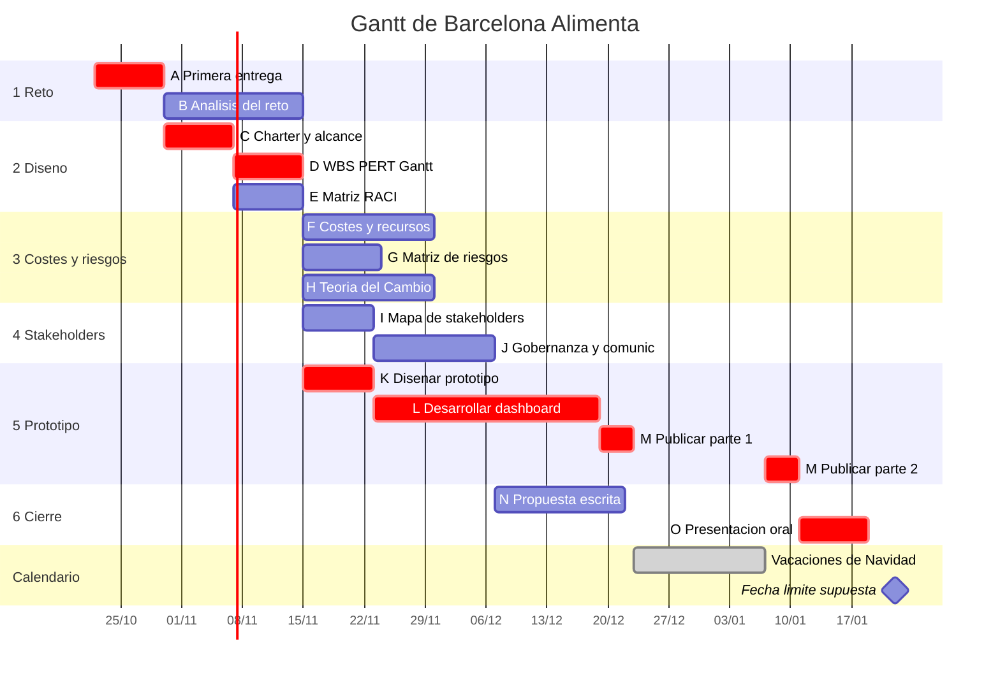

# Plan del proyecto: Barcelona Alimenta

- **Inicio:** 22/10/2026 (primera entrega).
- **Fin previsto:** 18/01/2027.
- **Vacaciones:** no se planifica trabajo durante las vacaciones de Navidad (23/12/2026 – 06/01/2027, calendario académico UAB 2026/27).
- **Fecha límite supuesta:** 22/01/2027, que es el fin del periodo de evaluación del primer semestre. **Hay que sustituirla por la fecha real cuando el profesor la confirme.**

Las duraciones están en semanas. Los valores a/m/b son estimaciones del grupo, y el cálculo completo, con fórmulas, está en [`pert.xlsx`](pert.xlsx).

## 1. WBS

```
Barcelona Alimenta (propuesta + prototipo)
├─ 1. Reto e idea
│   ├─ A  Primera entrega: enfoque y tema, repo, README, Gantt y Kanban iniciales
│   └─ B  Análisis del reto, datos y beneficiarios
├─ 2. Diseño y plan de gestión
│   ├─ C  Project charter, objetivos y alcance
│   ├─ D  WBS, PERT y Gantt detallados (versión revisada)
│   └─ E  Matriz RACI
├─ 3. Costes, riesgos e impacto
│   ├─ F  Costes, recursos y financiación
│   ├─ G  Matriz de riesgos
│   └─ H  Teoría del Cambio e indicadores de impacto
├─ 4. Stakeholders, gobernanza y comunicación
│   ├─ I  Mapa de stakeholders
│   └─ J  Gobernanza y estrategia de comunicación
├─ 5. Prototipo
│   ├─ K  Diseñar el prototipo (preguntas, indicadores, wireframe)
│   ├─ L  Desarrollar el dashboard (datos, mapa, indicadores)
│   └─ M  Publicar en GitHub Pages y redactar sobre.html
└─ 6. Cierre
    ├─ N  Redactar la propuesta escrita
    └─ O  Preparar y ensayar la presentación oral
```

## 2. Actividades, dependencias y PERT

te = (a + 4m + b) / 6 · σ² = ((b − a) / 6)² · Holgura = LS − ES

| ID | Actividad | Predec. | a | m | b | te | σ² | Holgura | Responsable |
|---|---|---|---|---|---|---|---|---|---|
| A | Primera entrega: enfoque, tema, repo, README, Gantt y Kanban | · | 1 | 1 | 2 | 1,17 | 0,03 | **0** | Oriol |
| B | Análisis del reto, datos y beneficiarios | A | 1 | 2 | 5 | 2,33 | 0,44 | 0,67 | Hèctor |
| C | Project charter, objetivos y alcance | A | 1 | 1 | 2 | 1,17 | 0,03 | **0** | Oriol |
| D | WBS, PERT y Gantt detallados | C | 1 | 1 | 2 | 1,17 | 0,03 | **0** | Oriol |
| E | Matriz RACI | C | 1 | 1 | 2 | 1,17 | 0,03 | 1,83 | Oriol |
| F | Costes, recursos y financiación | D | 1 | 2 | 4 | 2,17 | 0,25 | 1,67 | Xavier |
| G | Matriz de riesgos | D | 1 | 1 | 3 | 1,33 | 0,11 | 2,50 | Xavier |
| H | Teoría del Cambio e indicadores | B | 1 | 2 | 4 | 2,17 | 0,25 | 1,67 | Xavier |
| I | Mapa de stakeholders | B | 1 | 1 | 2 | 1,17 | 0,03 | 0,67 | Pol |
| J | Gobernanza y comunicación | I, E | 1 | 2 | 3 | 2,00 | 0,11 | 0,67 | Pol |
| K | Diseñar el prototipo | D | 1 | 1 | 2 | 1,17 | 0,03 | **0** | Hèctor |
| L | Desarrollar el dashboard | K | 2 | 3 | 8 | 3,67 | 1,00 | **0** | Hèctor |
| M | Publicar y redactar sobre.html | L | 1 | 1 | 2 | 1,17 | 0,03 | **0** | Hèctor |
| N | Redactar la propuesta escrita | F, G, H, J | 1 | 2 | 4 | 2,17 | 0,25 | 0,67 | Xavier |
| O | Preparar la presentación oral | N, M | 1 | 1 | 2 | 1,17 | 0,03 | **0** | Todos (Oriol coordina) |

**Resultado**

- Ruta crítica: **A → C → D → K → L → M → O**.
- Duración esperada: **T ≈ 10,67 semanas**.
- Varianza del proyecto (suma de las críticas): σ² ≈ 1,17, así que σ ≈ 1,08 semanas.
- Holguras:
  - B, I, J y N ≈ 0,7 semanas.
  - F y H ≈ 1,7 semanas.
  - E ≈ 1,8 semanas.
  - G ≈ 2,5 semanas.

**Probabilidad de cumplir el plazo** (semanas de trabajo contadas desde el 22/10/2026, sin las vacaciones):

| Fecha límite | Semanas de trabajo | z = (plazo − 10,67) / 1,08 | P(T ≤ plazo) |
|---|---|---|---|
| 22/12/2026 (antes de Navidad) | 8,86 | −1,68 | ≈ 5 % |
| 14/01/2027 | 10,00 | −0,62 | ≈ 27 % |
| **22/01/2027 (fecha supuesta)** | 11,14 | 0,44 | **≈ 67 %** |

Para otra fecha, se cambia en la hoja *Resumen* de [`pert.xlsx`](pert.xlsx). En Excel se calcula con `DISTR.NORM.ESTAND(z)`.

**Lectura**

- La actividad más incierta es L (desarrollar el dashboard), y además está en la ruta crítica.
- Con la fecha supuesta, la probabilidad de llegar a tiempo es aceptable pero no holgada. Si la entrega real es antes de Navidad, este plan no llega a tiempo.
- Para reducir el riesgo:
  1. Confirmar la fecha con el profesor cuanto antes.
  2. En B y K, validar pronto que los datasets existen y se pueden cruzar por barrio.
  3. Publicar en GitHub Pages una versión mínima del dashboard antes del 22/12, de modo que M y O después de vacaciones sean solo pulir y ensayar.

## 3. Gantt



- Las barras en rojo forman la ruta crítica.
- La tarea M queda partida en dos por las vacaciones.
- Las duraciones en días son te × 7, redondeado.

## 4. Tablero Kanban (GitHub Projects)

El tablero está enlazado desde el [README](../README.md#5-planificación). Tiene una issue por cada actividad (A–O), con su descripción, predecesoras, estimación y fechas.

- **Columnas (Status):** Por hacer · En curso · En revisión · Hecho. Cada persona tiene como máximo 2 o 3 tarjetas en «En curso».
- **Etiquetas de área:** `reto`, `diseño`, `costes-riesgos`, `stakeholders`, `prototipo`, `entrega`.
- **Etiquetas de estado:** `crítica` (ruta crítica) y `urgente` (para usar cuando haga falta).
- **Etiquetas de responsable:** `resp: Oriol`, `resp: Xavier`, `resp: Hèctor`, `resp: Pol`, `resp: Todos`.
- **Campos:** Inicio y Fin (fechas de la tabla siguiente), Responsable y Área.
- **Vistas:**
  - **Kanban** (por Status).
  - **Roadmap**, que sirve de Gantt vivo.
  - **Tabla.**
- **Rutina:** una reunión semanal de 15 minutos para mover tarjetas, actualizar fechas si algo se retrasa y revisar la ruta crítica.

Las fechas son inclusivas: el día de fin es el último día de trabajo.

| ID | Etiquetas | Inicio | Fin |
|---|---|---|---|
| A | reto, crítica | 22/10/2026 | 29/10/2026 |
| B | reto | 30/10/2026 | 14/11/2026 |
| C | diseño, crítica | 30/10/2026 | 06/11/2026 |
| D | diseño, crítica | 07/11/2026 | 14/11/2026 |
| E | diseño | 07/11/2026 | 14/11/2026 |
| F | costes-riesgos | 15/11/2026 | 29/11/2026 |
| G | costes-riesgos | 15/11/2026 | 23/11/2026 |
| H | costes-riesgos | 15/11/2026 | 29/11/2026 |
| I | stakeholders | 15/11/2026 | 22/11/2026 |
| J | stakeholders | 23/11/2026 | 06/12/2026 |
| K | prototipo, crítica | 15/11/2026 | 22/11/2026 |
| L | prototipo, crítica | 23/11/2026 | 18/12/2026 |
| M | prototipo, crítica | 19/12/2026 | 10/01/2027 (pausa 23/12–06/01) |
| N | entrega | 07/12/2026 | 21/12/2026 |
| O | entrega, crítica | 11/01/2027 | 18/01/2027 |

## 5. Riesgos principales (para la matriz de la tarea G)

| Riesgo | Prob. | Impacto | Respuesta |
|---|---|---|---|
| Un dataset no existe, está desactualizado o no se puede cruzar por barrio | Media | Alto | Validar los datasets en la tarea B; tener una alternativa |
| El dashboard generado con IA contiene errores | Media | Alto | Comprobar a mano una muestra de los números del dashboard frente a los datos originales |
| La fecha de entrega real es anterior a la supuesta | Media | Alto | Confirmar la fecha con el profesor; publicar una versión mínima del dashboard antes de vacaciones |
| Reparto desigual del trabajo en el grupo | Media | Medio | RACI, etiqueta de responsable en cada tarea y revisión semanal del tablero |
| Retrasos por otras entregas del cuatrimestre | Alta | Medio | Holguras visibles en el Gantt y priorizar la ruta crítica |
| Dificultad para contactar con stakeholders reales | Media | Bajo | Basarse en fuentes públicas y documentar los intereses |

## 6. Matriz RACI inicial

R = hace el trabajo · A = aprueba y responde del resultado · C = consultado · I = informado

| Actividad | Oriol | Xavier | Hèctor | Pol |
|---|---|---|---|---|
| A Primera entrega (tema, repo, plan inicial) | A/R | C | C | C |
| B Análisis del reto y datos | A | C | R | C |
| C-D Charter, WBS, PERT y Gantt | A/R | C | C | C |
| E Matriz RACI | A/R | C | C | C |
| F Costes y financiación | A | R | C | I |
| G Matriz de riesgos | A | R | C | C |
| H Teoría del Cambio e indicadores | A | R | C | C |
| I Mapa de stakeholders | A | C | I | R |
| J Gobernanza y comunicación | A | C | I | R |
| K-M Prototipo (diseño, dashboard, publicación) | A | C | R | C |
| N Propuesta escrita | A | R | C | C |
| O Presentación oral | A/R | R | R | R |
